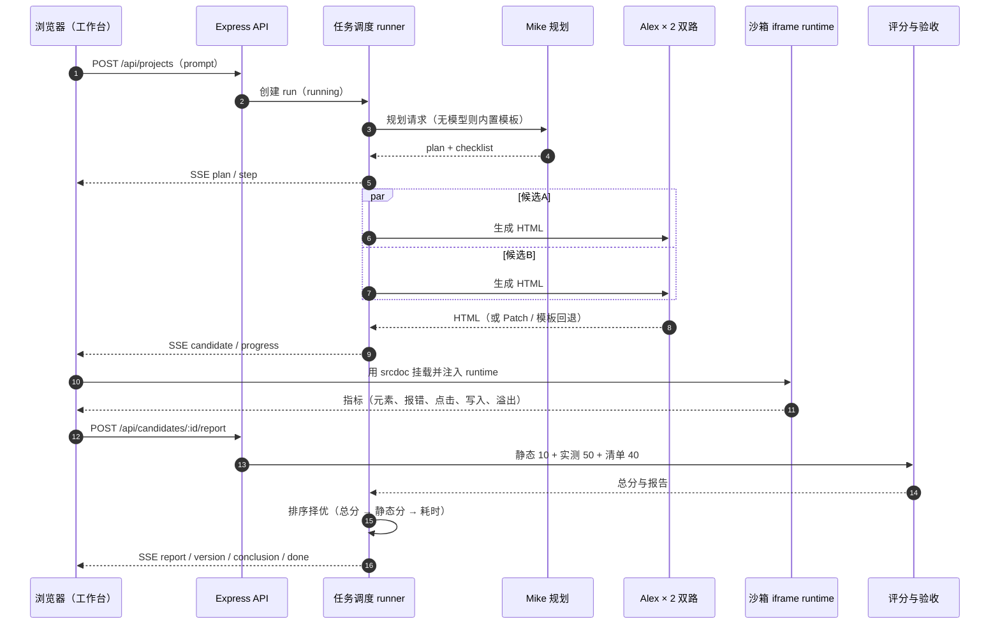
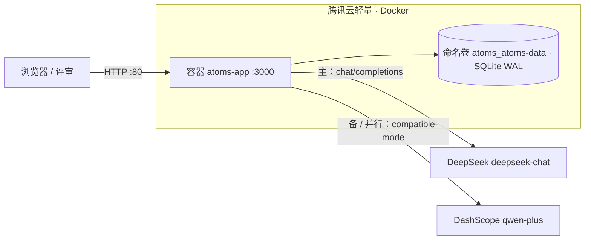

# Atoms Demo 说明文档

> 版本 v1.3（2026-11-13）｜仓库 [guojia3/atoms-demo](https://github.com/guojia3/atoms-demo)｜线上 <http://43.143.42.252>｜功能提交 `72c010d`（UI 改版）；文档与部署提交以仓库 HEAD 为准
> 旧版里程碑（M1/M2/M3）已降级为第 7.4 节「验证记录」，本文以设计与证据为主结构。

## 0 摘要与 3 分钟评审路径

### 0.1 一页摘要

| 项 | 内容 |
| --- | --- |
| 做了什么 | 一句话需求 → 双路并行生成单文件网页 → 浏览器沙箱实测 + 验收清单逐条判定 → 赛马择优 → 版本/回滚/发布；内置 6 个可交互成品；工作台支持桌面/平板/手机三档布局 |
| 最想让评审看到的 3 个设计 | ① 双路赛马 + 三段评分（静态 10 + 实测 50 + 清单 40），按总分/静态分/耗时择优；② 沙箱探针实测：验收基于真实点击、存储写入、运行时错误与横向溢出，而不是只读 HTML；③ Patch 局部修改（唯一锚点 + 失败回退全量）与版本、回滚、发布闭环 |
| 工程规模 | 39 个源码文件 / 7,472 行；14 个测试脚本（`test/` 13 个 + `script/smoke.ts`）；8 张 SQLite 表；27 个 HTTP 接口 |
| 在线地址 | <http://43.143.42.252>（Docker 部署，真模型，`mock=false`） |
| GitHub | <https://github.com/guojia3/atoms-demo>（UI 功能提交 `72c010d`；文档与部署提交以仓库 HEAD 为准） |
| 6 个成品直达 | [任务看板](http://43.143.42.252/s/k7m2x9) · [习惯打卡](http://43.143.42.252/s/h3t6w8) · [2048](http://43.143.42.252/s/g2a4m8) · [番茄专注](http://43.143.42.252/s/p6f3k9) · [Markdown 笔记](http://43.143.42.252/s/m4n8t2) · [记账本](http://43.143.42.252/s/e5x7b3) |
| 关键数字 | 单元 17/17、smoke 22/22、模板回归 38/38、移动端 9/9、手机 BUG 回归 14/14；独立 QA 复测 129/129 通过（首轮 121 条设计用例通过率 93.2%）；7 个缺陷 + 2 个手机 BUG 全部关闭；真模型复测创建 89.2s、编辑 7.4s |
| 诚实交代 | 交付形态是 HTTP + IP：Cookie 的 `Secure` 不启用（已知限制）；评分指标由客户端沙箱上报，理论上可篡改；限流与 SSE 事件在进程内，按单实例设计；旧 slug `/s/c4v8q1` 页面为 200 壳并提示已下线（API 404）；未接 CI；探针只覆盖 DOM 级交互，无视觉断言 |

### 0.2 3 分钟评审路径

1. 打开任一成品（建议 [2048](http://43.143.42.252/s/g2a4m8) 或 [记账本](http://43.143.42.252/s/e5x7b3)），在沙箱里真实操作并刷新页面，确认数据持久化。
2. 打开首页 <http://43.143.42.252>，输入一句话需求，观察执行记录 5 步与双路候选的实时进度。
3. 在预览区查看验收报告：总分、静态/实测/清单三段、双路赛马分数与「采用」标记。
4. 想核对工程证据：[测试方案](测试方案.md)、[测试用例与执行报告](测试用例与执行报告.md)、[README](../README.md)。

## 1 产品定位与 Atoms 能力取舍

### 1.1 产品定位

Atoms Demo 把一句话需求变成**可运行、可验收、可发布**的单页应用：不只生成代码，还在真实浏览器沙箱里实测，按验收清单逐条判定，再从多个候选里择优保存与发布。

| 角色 | 职责 | 无模型时 |
| --- | --- | --- |
| Mike（规划） | 输出标题、页面、功能、数据与验收清单 | 内置规划模板，固定 6 条清单 |
| Alex（工程） | 生成单文件 HTML；编辑优先局部补丁 | 6 套可交互模板 / 增量提示 |
| 验收官 | 按清单逐条判定并给出证据 | 由实测指标的可解释启发式映射 |

核心路径：

```
首页输入需求 → 需求拆解 → 双路并行生成 → 沙箱实测 + 清单验收 → 赛马择优 → 版本快照 → 发布 /s/:slug
```

### 1.2 与 Atoms 的能力对照

| Atoms 能力 | 我们的做法 | 取舍原因 |
| --- | --- | --- |
| 任务式生成 | 一句话建项目，产物收敛为单文件网页 | 单文件可离线、可沙箱验证、可一键发布 |
| 多智能体团队 | Mike / Alex / 验收官三角色串联 | 保留角色分工，不做自由对话编排 |
| 双路赛马 | `RACE_COUNT=2` 并行候选，评分择优 | 默认开启；可用环境变量降为单路 |
| App Viewer | `iframe srcdoc` 沙箱 + 注入 runtime | 不给 `allow-same-origin`，宿主与产物隔离 |
| Select to Chat | 沙箱点选回传 selector、标签、文本与 HTML 片段 | 只支持单元素点选，不做多选与画布标注 |
| Resolve / 一键修复 | 未通过项 + Console 报错拼成 `fix` 指令 | 复用编辑链路，失败不产生新版本 |
| 对话迭代 | messages + Patch 编辑，携带基础版本 | 单轮指令，未做长对话记忆压缩 |
| 版本与发布 | `versions` 线性版本、回滚、发布、分享页 | 不做分支/合并，保持数据模型简单 |
| 数据持久化 | runtime 覆写 `localStorage/sessionStorage`，同步到 SQLite KV | 只支持键值数据，不支持文件与数据库 |
| Deep Research / 附件 / 主题 / Google 登录 | 未做 | 聚焦「生成—验收—发布」闭环 |
| Emma / Bob 人设头像 | 不做，仅保留 Mike / Alex 命名 | 避免演示性装饰，减少误导 |
| Remix / 新标签页 / 代码视图 | 未做 | 优先级低于闭环与质量证据 |

## 2 总体架构与关键流程

### 2.1 技术栈

| 层 | 选型 | 说明 |
| --- | --- | --- |
| 前端 | React 19 + React Router 7 + Vite 6 + Tailwind CSS 4 | 4 个路由：`/`、`/p/:id`、`/s/:slug`、`/login`；SSE 驱动工作台 |
| 服务端 | Express 4 + tsx | 开发与生产同一入口 `src/server/index.ts`，无需编译产物 |
| 存储 | Node 内置 `node:sqlite`（WAL、外键、5s busy_timeout） | 零原生依赖，挂载单文件卷即可 |
| 实时 | SSE（事件带单调 `seq`，可按 `from` 回放） | 单向推送足够，避免 WebSocket 的心跳与重连复杂度 |
| 模型 | OpenAI 兼容 `/chat/completions`，多 provider JSON | 主 DeepSeek `deepseek-chat`，备 DashScope `qwen-plus`，失败自动切换 |
| 沙箱 | `iframe srcdoc` + 注入 runtime | CSP 禁外联；只回传消息，不共享宿主上下文 |

### 2.2 一次生成/编辑的时序



编辑与修复复用同一链路：`messages` 或 `fix` 指令进入 runner，携带基础版本生成 Patch，静态检查失败或补丁未唯一命中时回退全量重写，成功后写入新版本。

### 2.3 部署拓扑



80 与 3000 均映射到容器 3000；未启用域名与 443（见 5.3、6.3）。

### 2.4 运行状态与事件

| 维度 | 取值 |
| --- | --- |
| run 状态 | `running` / `done` / `failed` / `stopped` / `interrupted`（进程重启时把 `running` 标记为 `interrupted`） |
| SSE 事件 | `step`、`plan`、`progress`、`candidate`、`candidates`、`report`、`version`、`conclusion`、`done`、`error` |
| 回放 | 客户端带 `from` 断线重连，服务端按 `seq` 补发并对齐 snapshot；内存保留最近 400 条 |
| 步骤 | 拆解需求 → 生成页面 → 静态检查 + 浏览器实测 → 逐条验收 → 保存版本与结论 |

## 3 关键设计

### 3.1 技术选型与取舍

| 决策 | 备选 | 选它的理由 | 代价 |
| --- | --- | --- | --- |
| SSE 而非 WebSocket | WebSocket | 单向推送、天然断线重放、实现成本低 | 不能双向；事件表在进程内 |
| `node:sqlite` 单文件 | Postgres / better-sqlite3 | Node ≥22.5 内置、无原生编译、卷备份简单 | 单写者；多实例需换库 |
| 生成应用为单文件 HTML | 多文件工程 / 框架项目 | 离线可跑、沙箱可验、发布即一个 `srcdoc` | 无法表达路由与后端 |
| 客户端沙箱探针 | 服务端无头浏览器 | 不需要服务器装 Chromium，2C 机器可跑 | 指标可由页面伪造；覆盖仅 DOM 级 |
| Patch 优先编辑 | 整份重写 | 改动小、省 token、局部可审 | 模型输出协议失败需回退 |
| 双路赛马 | 单路生成 | 同一需求两条实现，用分数拉开差距 | 生成耗时与配额翻倍 |
| 三个 Agent 串联 | 自由多 Agent 编排 | 职责清晰、可解释、可回退 | 无长对话记忆与工具规划 |

### 3.2 生成链路

- **规划**：模型输出标题、页面、功能、数据与验收清单；解析失败或 Mock 模式回落内置模板（固定 6 条清单）。
- **生成**：提示词包含需求、计划、清单与目标版本；模型可分片流式输出，前端按字符累计并展示尾部。
- **编辑**：优先输出 `{"patches":[{"find","replace"}]}`；服务端要求 `find` 在全文中唯一命中，应用后再跑静态检查；命中 0 次或多于 1 次、或静态检查失败则回退全量重写。
- **修复**：报告未通过项与 Console 报错拼成 `fix` 指令，复用编辑链路；失败不产生新版本。
- **验收**：有模型时按清单逐条返回通过/证据；无模型时用可解释启发式（交互、持久化、报错、移动端、渲染、通用完整性）映射到实测指标。

代码落点：[planner.ts](../src/server/agents/planner.ts)、[engineer.ts](../src/server/agents/engineer.ts)、[reviewer.ts](../src/server/agents/reviewer.ts)、[llm/client.ts](../src/server/llm/client.ts)、[jobs/runner.ts](../src/server/jobs/runner.ts)。

### 3.3 评分与择优

总分 100 = 静态 10 + 浏览器实测 50 + 清单 40。

静态完整性（[static-check.ts](../src/server/verify/static-check.ts)）：

| 检查项 | 分值 | 判定 |
| --- | --- | --- |
| `<!DOCTYPE html>` | 1 | 文件以 doctype 开头 |
| 以 `</html>` 结束 | 1 | 判断是否被截断 |
| 含内联 `<script>` | 2 | 无脚本则不可交互 |
| 含 viewport meta | 2 | 移动端适配前提 |
| 无外部依赖 | 2 | `src/href` 不得指向 http(s)/协议相对地址 |
| 内容 ≥ 2KB | 2 | 排除空壳页面 |

浏览器实测（[score.ts](../src/server/verify/score.ts)，全部来自沙箱上报）：

| 项 | 分值 | 规则 |
| --- | --- | --- |
| 页面渲染 | 10 | 元素 ≥15 且可见字符 ≥40 → 10；≥8/≥15 → 6；>0 → 3 |
| 无运行时报错 | 10 | 0 条 → 10；1 条 → 6；2 条 → 3；≥3 → 0 |
| 交互可用 | 15 | 模拟点击 ≥2 且界面变化 ≥1 → 15；点击 ≥1 且变化 ≥1 → 11；点击 ≥1 → 6 |
| 数据持久化调用 | 10 | 有写入或已有键 → 10 |
| 移动端适配 | 5 | 375px 无横向溢出 → 5 |

清单 40 = `round(40 × 通过条数 / 清单条数)`；模型判定不可用时回退启发式，报告标注 `reviewSource`。

择优排序：总分降序 → 静态分降序 → 生成耗时升序；同分时更快且结构更完整的候选被采用，报告中保留每个候选的分数与「采用」标记（[runner.ts](../src/server/jobs/runner.ts)）。

### 3.4 沙箱与 KV

- **隔离**：`iframe srcdoc`，`sandbox="allow-scripts allow-forms allow-downloads"`（已移除 `allow-modals`），**不给** `allow-same-origin`；沙箱文档 CSP 维持 `default-src 'none'`、`connect-src 'none'`、`form-action 'none'`，外部网络被阻断。
- **对话框替身**：runtime 在页面脚本之前接管 `alert/confirm/prompt`。探针模式 `confirm` 直接返回 `false`、`alert` 静默、`prompt` 返回 `null`；手动模式用非阻塞 toast + 3 秒内二次点击确认替代原生确认框，`prompt` 返回 `null` 并提示在页面内输入。生成/验收探针与分享页手动删除共用同一替身。
- **高度自适应**：runtime 监听 `load`、`resize` 与 DOM 变化，通过 `atoms-height` 上报内容高度；分享页 `Sandbox autoHeight` 按上报值撑开 iframe，父容器不再固定高度裁切（工作台预览保持 `h-full`，不启用自适应）。
- **storage 替身**：runtime 覆写 `localStorage/sessionStorage` 为内存实现，写入经 250ms 合并后 `postMessage` 给宿主，宿主再写服务端。
- **作用域**：所有者 `owner`、分享访客 `visitor:<vid>` 分开存储，访客之间互不可见。
- **边界**：单键 ≤200 字符、单值 ≤200KB、单作用域 ≤200 键；非法操作整批拒绝并返回 400（[store.ts](../src/server/store.ts) `applyKvOps`）。
- **回灌顺序**：分享页等 `/api/share/:slug` 与 `/kv` 返回后才挂载沙箱，避免 iframe 先以空存储启动一次（[SharePage.tsx](../src/client/pages/SharePage.tsx)）。
- **上报**：同一 runtime 采集报错、DOM 变化、点击/输入、横向溢出；收到探针指令后，从可点击元素的首/中/尾各取最多 3 个（总计最多 10 个）逐个点击，统计界面变化并回报指标。

代码落点：[runtime.ts](../src/shared/runtime.ts)、[Sandbox.tsx](../src/client/components/Sandbox.tsx)、[share.ts](../src/server/routes/share.ts)、[SharePage.tsx](../src/client/pages/SharePage.tsx)、[store.ts](../src/server/store.ts)。

### 3.5 安全设计

| 项 | 实现 |
| --- | --- |
| 安全响应头 | `X-Content-Type-Options: nosniff`、`X-Frame-Options: DENY`、`Referrer-Policy: strict-origin-when-cross-origin`、`Permissions-Policy`（禁用摄像头/麦克风/定位/支付/USB）、CSP（`frame-ancestors 'none'`、`object-src 'none'`、`base-uri 'self'`、`form-action 'self'`）；移除 `X-Powered-By` |
| CSP 兼容 | 页面级 CSP 不设 `default-src`/`frame-src`，允许 inline/eval，保证 `srcdoc` 沙箱与 SSE 正常；沙箱文档另行收紧 |
| 生成限流 | 每用户每小时 20 次（`GENERATION_RATE_LIMIT`），创建/编辑/修复/重试统一计数；游客与升级账号按同一 `user.id`；超限 429 + `Retry-After`（[auth.ts](../src/server/auth.ts)） |
| 请求体 | `express.json({ limit: 1mb })`；`entity.too.large` → 413、`entity.parse.failed` → 400，不再吞成 500 |
| 跨站写请求 | `POST/PUT/PATCH/DELETE` 校验 `Origin`（缺失时用 `Referer`）：同源与 `PUBLIC_ORIGIN` 放行；`null` 与其它来源 403；无来源头（curl/smoke）放行 |
| 会话 | `HttpOnly + SameSite=Lax`；`trust proxy` + `X-Forwarded-Proto: https` 时自动加 `Secure`，HTTP 直连不加（见 6.4） |
| 口令 | scrypt 哈希 + 随机盐；会话只存 token 哈希，不落明文 |
| 注入 | 分享 slug 与项目 ID 走参数化查询；页面内容以文本/HTML 转义注入，未拼接可执行模板 |

代码落点：[index.ts](../src/server/index.ts)、[auth.ts](../src/server/auth.ts)、[routes/projects.ts](../src/server/routes/projects.ts)、[routes/runs.ts](../src/server/routes/runs.ts)。

### 3.6 迭代、版本与发布

- **版本号**：`versions(project_id, seq)` 唯一约束，事务内自增，冲突重试 3 次；每次保存完整 HTML 与报告快照。
- **回滚**：恢复指定版本会生成新版本（`source=restore`），历史版本保留，不删除。
- **发布**：项目持有一个短 slug，`published_version_id` 指向发布版本；`/s/:slug` 与 `/api/share/:slug` 公开只读。
- **来源标注**：仅 `generate`/`edit` 标「模型生成」；`mock`/`fallback`/`restore` 分别标「内置示例（模板）」「回退版本」「恢复版本」，避免模板产物被误标。
- **预制成品**：启动时幂等写入 6 个种子成品（看板、习惯、2048、番茄、笔记、记账）；历史计算器 slug `c4v8q1` 在启动时删除，旧链接 API 404、页面提示已下线。

代码落点：[routes/projects.ts](../src/server/routes/projects.ts)、[store.ts](../src/server/store.ts)、[seed.ts](../src/server/seed.ts)、[SharePage.tsx](../src/client/pages/SharePage.tsx)。

### 3.7 界面设计语言

参考 atoms.dev 官方产品的设计语言，**全部为原创实现**（未复用任何素材、字体文件或组件代码），统一在 [styles.css](../src/client/styles.css) 定义 token：

| 维度 | 取值 | 说明 |
| --- | --- | --- |
| 画布 | 纸灰 `#f6f6f6` / `#f8f8f6` | 页面底色，弱化装饰，突出内容 |
| 表面 | 纯白 `#ffffff` | 卡片、输入区、报告区；以 1px 描边替代重阴影 |
| 描边 | `rgba(12,12,12,0.06)` / `0.12`（强） | 卡片与分隔线；悬停时描边加深 |
| 强调色 | 钴蓝 `#4267ff`（hover `#3355e6`，soft `12%`） | 主按钮、选中态、链接与进度；全站唯一强调色 |
| 控件 | 8–10px 圆角按钮 + `9999px` 胶囊（标签、分段、状态） | 高度 36px、13px 字号，几乎无阴影 |
| 字体 | 系统字体栈 `IBM Plex Sans / SF Pro Text / -apple-system / PingFang SC` | 不下载外部字体，离线与国内网络均可直出 |
| 反馈色 | 成功 `#0f9f6e`、警告 `#b45309`、失败 `#dc2626` | 仅用于实测评语、分数档与错误提示 |
| 响应式 | 桌面 / 平板 / 手机三档 | 工作台 ≥1280px 三栏、768–1279px 抽屉、<768px 单栏；分享页内容自适应高度 |

视觉证据：[首页 375](evidence/home-375.png) / [首页 1440](evidence/home-1440.png)、[工作台 375](evidence/workspace-375.png) / [工作台 1440](evidence/workspace-1440.png)、[分享页 375](evidence/share-375.png) / [分享页 1440](evidence/share-1440.png)。

## 4 数据模型与接口契约

### 4.1 数据表（8 张）

| 表 | 作用 | 关键约束 |
| --- | --- | --- |
| `users` | 游客/邮箱账号 | `email UNIQUE`，`password_hash` 仅邮箱账号有值 |
| `sessions` | 会话 | 主键为 token 哈希，`expires_at` |
| `projects` | 项目 | `share_slug UNIQUE`，`(user_id, updated_at)` 索引 |
| `versions` | 版本快照 | `UNIQUE(project_id, seq)`，存 HTML 与报告 JSON |
| `messages` | 对话与通知 | `(project_id, created_at)` 索引 |
| `runs` | 一次创建/编辑/修复 | `mode`、`status`、`base_version_id` |
| `candidates` | 赛马候选 | `(run_id)` 索引，存分数与报告 |
| `app_data` | 生成应用 KV | 主键 `(project_id, scope, key)` |

完整字段见附录 C。所有业务表对 `projects` 外键级联删除；SQLite 开启 `foreign_keys=ON`、WAL、`busy_timeout=5000`（[db.ts](../src/server/db.ts)）。

### 4.2 接口契约

| 分类 | 接口 |
| --- | --- |
| 健康与配置 | `GET /api/health`、`GET /api/config` |
| 身份 | `GET /api/me`、`POST /api/auth/register`、`POST /api/auth/login`、`POST /api/auth/logout` |
| 项目 | `GET/POST /api/projects`、`GET /api/samples`、`GET/PATCH/DELETE /api/projects/:id`、`POST /api/projects/:id/messages`、`POST /api/projects/:id/publish`、`POST /api/projects/:id/unpublish`、`POST /api/projects/:id/versions/:vid/restore`、`GET /api/projects/:id/versions/:vid/html`、`GET/POST /api/projects/:id/kv` |
| 运行 | `GET /api/runs/:id/events`（SSE）、`POST /api/runs/:id/stop`、`POST /api/runs/:id/retry`、`GET /api/candidates/:id/html`、`POST /api/candidates/:id/report` |
| 分享 | `GET /api/share/:slug`、`GET/POST /api/share/:slug/kv` |

错误码：400（参数/KV/非法 JSON）、401（未登录/会话失效）、403（跨站来源）、404（项目/版本/分享不存在）、409（邮箱已注册）、413（请求体超限）、429（生成配额）、500（兜底 JSON）。明细见附录 A。

### 4.3 一致性约定

- 版本号在事务内自增，`UNIQUE(project_id, seq)` 冲突重试 3 次。
- KV 批量操作先构造完整 `next` 再在一个事务里写入，任一条非法整批拒绝。
- 停止是终态：写入 `stopped` 后收尾分支只补 `finished_at`，不会覆盖为 `failed`。
- 进程启动把遗留 `running` 运行标记为 `interrupted`，不悬挂任务。

## 5 安全、可靠性与运维

### 5.1 安全基线

- 响应头与 CSP 见 3.5；页面与 API 均生效，实测无 `X-Powered-By`。
- 限流：生成 20 次/小时/用户；登录与注册按 IP 各 20 次/10 分钟防爆破；均返回 `Retry-After`。
- Cookie：`HttpOnly; SameSite=Lax`；HTTPS 反代场景自动加 `Secure`，HTTP 直连不加。
- 上传面：无文件上传接口；请求体上限 1MB；拒绝畸形 JSON 与超限体。
- 越权：所有项目/版本/KV/运行接口校验 `user_id`；越权访问统一 404（QA 越权矩阵 8/8 通过）。
- 密钥：真实 Key 只在本地与服务器 `.env`（服务器 `chmod 600`），不入库、不下发前端；`/api/config` 只返回 provider 名称与模型名。

### 5.2 可靠性设计

| 场景 | 处理 |
| --- | --- |
| SSE 断线 | 事件带 `seq`，带 `from` 回放并对齐 snapshot；内存保留 400 条 |
| 停止运行 | `stopRun` 写 `stopped` 为终态，收尾异常不覆盖 |
| 进程重启 | `running` → `interrupted`；容器 `restart: unless-stopped` 自恢复 |
| 模型失败 | provider 轮换；全部失败回落内置模板（`fallback`） |
| 探针超时 | 默认 15s，超时按 0 分收尾但保存版本，可重试/修复 |
| 版本冲突 | 事务内自增 + 3 次重试 |
| 并发 | 同一项目运行互斥；KV 合并后串行提交 |

### 5.3 部署拓扑与运维

| 项 | 值 |
| --- | --- |
| 主机 | 腾讯云轻量应用服务器，Ubuntu 24.04 x86_64，2C，公网 `43.143.42.252` |
| 运行 | Docker + Compose，容器 `atoms-app`，镜像 `atoms-atoms:latest`，`restart: unless-stopped` |
| 端口 | 宿主 80 与 3000 → 容器 3000；公网入口为 80 |
| 数据 | 命名卷 `atoms_atoms-data` → 容器 `/data/atoms.db`（WAL） |
| 健康检查 | 容器内 `wget /api/health`，30s 间隔，3 次重试，10s 启动宽限 |
| 配置 | `.env`（`chmod 600`），只存模型 Key 与运行参数，不入库 |
| 发布 | `deploy/deploy.sh` 支持密钥或 `SSH_PASSWORD` 环境变量，按 `git rev-parse --short HEAD` 注入 `GIT_COMMIT`，rsync 上传后在服务器构建并 `compose up -d --build`，保留卷 |
| 回滚 | 重新部署上一提交即可；卷与 `atoms.db` 不动，旧分享链接保持可用 |
| 排障 | `docker compose ps` / `docker compose logs -f --tail=200 atoms` / `curl -s :80/api/health` |

### 5.4 可观测与已知缺口

- `/api/health` 返回 `ok`、`db`、`mock`、`providers`、`probeTimeoutSec`、`commit`、`time`；部署构建会注入 `GIT_COMMIT`，可直接核对线上版本（本地开发默认空）。
- 无结构化日志、指标与追踪；排障依赖容器日志与 QA 脚本。已列入 9.1 P1。

## 6 完成度

### 6.1 交付要求逐项对照

| 验收要求（按交付标准归纳） | 实现 | 证据 |
| --- | --- | --- |
| 可运行的网页应用 | 首页、工作台、分享页、登录页 4 条路由 | 线上 200；smoke 22/22 |
| 一句话生成 | 首页输入 → `/api/projects` → 规划 + 双路生成 | 真模型复测创建 89.2s（DeepSeek 9.9s / 千问 82.9s） |
| 生成过程实时可视化 | 执行记录 5 步 + SSE `progress`/`plan`/`candidate` | 工作台可见步骤与字符流；断线可回放 |
| 真实交互与数据持久化 | 沙箱探针模拟点击；storage 覆写 + KV 同步 | 实测 50 分制；6 成品刷新后数据保留（38/38） |
| 初始化、注册/登录与主流程 | 游客自动建号 → 升级邮箱账号 → 登录/登出/换设备 | smoke 覆盖游客升级与换设备登录 |
| 双路赛马与择优 | 2 候选并行，总分/静态/耗时排序 | 报告展示两路分数与「采用」；真模型两路均参与 |
| 追加修改与一键修复 | Patch 编辑 + `fix` 指令 | v2 编辑、v3 修复；补丁命中 4/4，失败回退全量 |
| 版本与发布 | 线性版本、回滚、发布、短链分享 | v1/v2/v3；`/s/:slug` 公开可访问 |
| 在线可用、非 PoC | 容器部署 + 双 provider + 数据卷 | `mock=false`；公网 smoke 22/22；重启后服务自恢复 |

### 6.2 已完成模块

| 模块 | 能力 |
| --- | --- |
| 规划 | 模型/模板计划，6 条验收清单 |
| 生成 | 双路并行、流式输出、模板回退 |
| 验收 | 静态 10 + 实测 50 + 清单 40，模型/启发式双判定 |
| 赛马 | 排序择优、报告对比、采用标记 |
| 迭代 | 消息编辑、点选编辑、一键修复、Patch 失败回退全量 |
| 版本 | 快照、回滚（restore）、历史保留 |
| 发布 | slug、发布/取消发布、公开分享页、访客 KV 隔离 |
| 身份 | 游客、邮箱注册/登录、游客升级、会话轮换 |
| 预制成品 | 6 个可交互模板，首页成品卡与直达链接 |
| 工作台 | ≥1280px 固定左栏（400px，最小 320px）；768–1279px 可收起抽屉（380px）；<768px 对话/预览切换 |
| 安全与限额 | 5 类响应头 + CSP、生成限流、body 上限、跨站校验、Cookie 基线 |

### 6.3 未做清单

| 未做 | 原因 |
| --- | --- |
| 多轮长对话与记忆压缩 | 单轮指令已覆盖编辑/修复，优先级低于闭环 |
| 生成应用自带后端/多文件工程 | 单文件沙箱模型无法承载，需另立运行时 |
| 代码视图、导出 zip、新标签页、Remix | 属编辑器能力，非本次验收项 |
| 附件、主题、Google 登录 | 未在题目硬性要求内 |
| CI（GitHub Actions） | 本地脚本已覆盖，接入 CI 需额外时间 |
| HTTPS / 域名 / Caddy / 443 | 交付形态定为 HTTP + IP；启用后 Cookie 自动加 `Secure` |
| 多实例与任务队列 | 当前单实例设计，进程内事件与限流 |
| 审计日志、结构化日志、指标追踪 | 仅保留容器日志与 health |
| 视觉回归/截图 diff | 探针只做 DOM 级断言 |
| 沙箱底层逃逸验证 | 未做浏览器 0day 级利用验证，仅按 CSP/属性收敛 |

### 6.4 局限清单

| 局限 | 影响 |
| --- | --- |
| 评分指标由客户端沙箱上报 | 恶意页面可伪造指标刷分；服务端未复核 |
| 探针只覆盖 DOM 点击 | 菜单、滚动、拖拽、Canvas、视觉错位无法判定 |
| 限流在进程内 | 重启或多实例会重置配额 |
| SSE 事件内存保留 400 条 | 长断线只能对齐 snapshot，早期事件丢失 |
| 任务调度在进程内 | 重启后运行标记 `interrupted`，不自动续跑 |
| SQLite 单写者 | 高并发写需换库；当前 busy_timeout 5s |
| 分享页只读且无权限体系 | 任何拿到 slug 的人可访问；访客数据按 `vid` 隔离 |
| HTTP 直连不启用 `Secure` | Cookie 明文传输，仅适用于演示 |
| 本地开发未注入 `GIT_COMMIT` | 仅部署环境可通过 `health.commit` 核对线上版本 |
| 页面 CSP 允许 `unsafe-inline`/`unsafe-eval` | React 运行时与生成应用所需，降低 CSP 强度 |
| 模型输出协议不稳定 | Patch 可能未唯一命中，触发全量重写 |
| 无 i18n、无暗色主题 | 仅中文浅色界面 |

## 7 质量证据

### 7.1 测试矩阵

| 套件 | 文件 | 数量 | 最近结果 |
| --- | --- | --- | --- |
| 单元 | [test/unit-qa.ts](../test/unit-qa.ts) | 17 | 17/17 PASS |
| API/安全/并发/异常 | [test/api-qa.ts](../test/api-qa.ts) | 53 | 见 QA 报告执行明细 |
| 韧性 | [test/resilience-qa.ts](../test/resilience-qa.ts) | 10 | 10/10 PASS |
| 重启恢复 | [test/restart-check.ts](../test/restart-check.ts) | 3 | 3/3 PASS |
| 缺陷回归 | [test/regression-defects.ts](../test/regression-defects.ts) | 10 | 10/10 PASS |
| 模板与成品 | [test/templates-check.mjs](../test/templates-check.mjs) | 38 | 38/38 PASS（本地与线上） |
| 移动端 | [test/mobile-check.mjs](../test/mobile-check.mjs) | 9 | 9/9 PASS |
| 手机 BUG 回归 | [test/mobile-bugs-check.mjs](../test/mobile-bugs-check.mjs) | 14 | 14/14 PASS（375/390 棋盘可见性、dialog=0、探针时效与评分） |
| 端到端 | `npm run smoke`（[script/smoke.ts](../script/smoke.ts)） | 22 | 22/22 PASS（Mock 与公网真模型） |
| 真模型 | [test/real-model-check.ts](../test/real-model-check.ts) | 2 | 创建 89.2s / 编辑 7.4s，PASS |

### 7.2 独立 QA 结论

| 指标 | 首轮 | 复测（修复版） |
| --- | --- | --- |
| 设计用例 | 121 | 131（121 + 缺陷回归 10） |
| 执行/通过 | 117 执行，109 通过 | 129 执行，129 通过 |
| 通过率 | 93.2% | 100% |
| P0 | 56/56 = 100% | 56/56 = 100% |
| P1 | 58 设计，57 执行，51 通过 = 89.5% | 58/58 = 100% |
| 缺陷 | 8 条用例失败，归并为 7 个缺陷（S3×5、S4×2；DEF-06 为编号占位） | 7 个全部关闭，0 未关闭 |

完整过程见 [测试方案](测试方案.md) 与 [测试用例与执行报告](测试用例与执行报告.md)。

### 7.3 缺陷闭环

| ID | 级别 | 问题 | 修复 | 回归证据 |
| --- | --- | --- | --- | --- |
| DEF-01 | S3 | 无生成限流 | 每用户每小时 20 次滑动窗口，429 + `Retry-After` | CON01：20×201，第 21 次 429 |
| DEF-02 | S3 | 超大 body / 畸形 JSON 返回 500 | 全局错误映射 413/400 | SEC03/SEC04 PASS |
| DEF-03 | S3 | 缺基础安全响应头 | 5 类头 + CSP，移除 `X-Powered-By` | SEC05 PASS |
| DEF-04 | S3 | 会话 Cookie 无 `Secure` | HTTPS 反代时自动加；HTTP 不加（已知限制） | SEC06 PASS |
| DEF-05 | S4 | 跨站 Origin 写请求未校验 | 同源/配置来源放行，其它 403 | SEC08 PASS |
| DEF-07 | S4 | 模板/回退版本误标「模型生成」 | 仅 `generate/edit` 标模型生成 | API38 PASS |
| DEF-08 | S3 | 停止后终态被覆盖为 `failed` | 终态保护，收尾只补 `finished_at` | EX07 PASS |

### 7.4 验证记录（M1–M5，代替旧里程碑）

| 阶段 | 内容 | 证据 |
| --- | --- | --- |
| M1 本地闭环 | 首页 → 生成 → 预览 → 保存 v1 → 发布 | 类型检查、构建、接口与浏览器主链路 |
| M2 赛马与迭代 | 双路择优、Patch 编辑、点选编辑、一键修复 | smoke 22 项（含 v2/v3、访客隔离、游客升级） |
| M3 真模型与部署 | deepseek-chat + qwen-plus、容器上线、卷保留 | 公网 smoke 22/22；`mock=false`；旧分享页仍 200 |
| M4 独立 QA 与修复 | 121 条用例、7 缺陷、回归脚本 | 复测 129/129；缺陷 0 未关闭 |
| M5 成品与工作台 | 6 个可交互成品、计算器下线、响应式修复 | 模板回归 38/38；375/1024/1280/1440 无溢出、无 console 报错 |

### 7.5 密钥与提交前检查

- **密钥扫描**：仓库源码、构建产物、文档中无 `sk-`/API Key/私钥/口令命中；真实 Key 仅存在 `.env`（服务器 `chmod 600`，本地 gitignored），不下发前端、不进日志。
- **`.gitignore` 覆盖**：`.env`、`data/`、`dist/`、`node_modules/`、`test/results/`、`*.db`。
- **提交前清单**：`npm run typecheck` → `npm run build` → 单元 → smoke → 模板回归 → 移动端 → 手机 BUG 回归（2048 375/390、dialog=0、探针时效）→ 375 视口自检 → `git status` 仅含预期文件 → 不含截图/数据库/密钥。
- **部署后核验**：`/api/health`（ok、db、mock、providers）→ 安全头 → `/api/samples` 6 条 → 6 分享页 200 → 公网 smoke 22/22 → 数据卷历史分享页仍 200（卷保留）。

### 7.6 复现命令

```bash
npm ci
npm run typecheck
npm run build
MOCK_MODE=1 PORT=3300 npm start          # Mock 隔离实例
SMOKE_BASE_URL=http://127.0.0.1:3300 npm run smoke
npx tsx test/unit-qa.ts
QA_BASE=http://127.0.0.1:3300 node test/templates-check.mjs
```

## 8 踩坑与修复

| 现象 | 根因 | 修复 | 回归证据 |
| --- | --- | --- | --- |
| BUG-01：375px 手机分享页 2048 棋盘底部被裁，且棋盘 `touch-action:none` 导致被裁区域无法滚动 | 分享页 iframe 固定 `h-[calc(100vh-220px)] min-h-[420px]` + 外层 `overflow-hidden`；2048 窄屏仍保留副标题、长提示与 24px/14px 内边距，内容高度超过容器 | ① runtime 上报内容高度，`Sandbox` 增加 `autoHeight`（仅分享页启用），分享页容器改为内容自适应；② 2048 `≤420px` 紧凑布局：隐藏副标题与提示、缩小 padding/HUD，棋盘 `max-width:min(100%,360px)`；工作台预览保持 `h-full` | 375×812 / 390×844 棋盘 16 格 4 行完整可见（底部 431/480、446/480），无横向溢出；刷新后局面保留（3 个方块）；1440 桌面棋盘 460px 不回归 |
| BUG-02：工作台生成应用点「清空/删除」弹浏览器原生 confirm，阻塞生成/验收探针，9s 超时后评分偏低 | iframe 带 `allow-modals`，runtime 未接管 `alert/confirm/prompt`，探针批量点击按钮时同步原生对话框挂起页面 | runtime 在页面脚本前注入对话框替身：探针模式 `confirm=false`、`alert` 静默、`prompt=null`；手动模式 toast + 3 秒内二次点击确认；移除 `allow-modals`；`notes` 删除复用同一替身；探针结束立即清理 `probing` | 工作台 notes 项目实测分 50/50、v1 评分 100、dialog=0、探针 4.0s 内完成；分享页探针 610ms 返回、dialog=0；删除首次点击提示二次确认、二次点击删除成功；探针后恢复手动模式 |
| 预制成品「计算器」点击后按钮全失效 | 本地服务是旧进程未重载，仍在返回旧模板；旧模板正则字符类范围倒置（`[0-9+-*/.()% ]`）触发 `SyntaxError`，整页脚本崩溃 | 重启实例；计算器从成品库下线并删除模板，启动时按 `RETIRED_SAMPLE_SLUGS` 清理旧库项目 | 旧链接 `/s/c4v8q1` API 404、页面提示已下线；其余 6 成品 38/38 PASS |
| 工作台清单在中等宽度下逐字竖排、报告显示不全 | 报告行的证据 span `shrink-0` 且无宽度上限，实测 716px，被卡片裁切，同时把清单文本列压到 32px（约每行 3 字） | 证据 `max-w-[45%] truncate`、文本 `min-w-0 break-words`；左栏 ≥1280px 固定 400px + 最小 320px + `shrink-0`；768–1279px 改为可收起抽屉 | 同一行文本列 160px（约 13 字/行）；1024/1440 无横向溢出，console 0 报错 |
| 分享页刷新后像「数据丢失」 | iframe 先以空 KV 挂载，随后才拉到服务端数据 | KV 就绪后再挂载沙箱 | 分享页刷新数据保留；模板回归 38/38 |
| 模板版本被标为「模型生成」 | 仅按 `source` 粗糙判断 | 仅 `generate/edit` 视为模型生成，其余标模板/回退/恢复 | API38 PASS（DEF-07） |
| 停止后运行终态变成 `failed` | 收尾异常分支覆盖了 `stopped` | 终态保护，收尾只补时间 | EX07 PASS（DEF-08） |
| 4.6MB 请求体与畸形 JSON 被 500 吞掉 | 无全局错误映射 | `entity.too.large` → 413、`parse.failed` → 400 | SEC03/SEC04 PASS（DEF-02） |
| 8 并发生成全 201 | 无生成配额 | 滑动窗口 20 次/小时 + `Retry-After` | CON01：第 21 次 429（DEF-01） |
| 页面缺安全响应头 | 无统一中间件 | 5 类头 + CSP，移除 `X-Powered-By` | SEC05 PASS（DEF-03） |

## 9 风险与后续

### 9.1 风险与改进优先级

| 优先级 | 风险 | 影响 | 建议 |
| --- | --- | --- | --- |
| P0 | HTTP + IP，无 HTTPS；`Secure` 不启用 | 会话与内容明文传输，仅适合演示 | 上域名 + Caddy/443；代码已支持自动加 `Secure` |
| P0 | 评分指标由客户端上报 | 恶意页面可伪造分数获得「采用」 | 关键指标服务端探针复核，或对上报做签名/抽样复核 |
| P0 | 限流与任务在进程内 | 重启/多实例失效，配额可绕过 | 限流落库或 Redis；任务队列持久化 |
| P1 | 探针覆盖仅 DOM 点击 | 视觉与复杂交互缺陷漏判 | 增加滚动/弹窗/拖拽脚本；引入截图 diff |
| P1 | SQLite 单写者 | 高并发写排队 | 读写分离或换 Postgres |
| P1 | 无 CI | 回归依赖手动执行 | GitHub Actions：typecheck/build/unit/smoke/模板回归 |
| P1 | SSE 事件仅 400 条 | 长断线丢早期事件 | 事件落库或提高环形缓冲 |
| P2 | 无结构化日志/指标/追踪 | 线上排障成本高 | 接入轻量日志与指标端点 |
| P2 | 单文件工程、无代码视图/导出 | 复杂应用表达受限 | 多文件运行时与导出 zip |
| P2 | 无审计日志 | 无法追溯操作 | 记录发布/回滚/删除事件 |

### 9.2 评估维度对照

| 维度 | 我们的表现 | 主要证据 |
| --- | --- | --- |
| 完成度 | 生成—验收—发布闭环完整，6 个成品可直接体验 | 0.2 评审路径、6.1 对照表、公网 smoke 22/22 |
| 工程思维 | 三段评分、Patch 回退、终态保护、KV 边界、断线回放 | 3.3、3.4、5.2、8 |
| UX / 产品感 | 参考 atoms.dev 的纸灰画布 + 纯白表面 + 钴蓝强调设计语言（原创实现）；执行记录可见、双路分数对比、报告可展开、三档响应式布局 | 3.7、`docs/evidence/` 新版 375/1440 截图 |
| 创新点 | 沙箱实测打分与赛马择优、模板成品即数据 | 3.2、3.3、3.6 |
| 可交付性 | Docker 单容器、卷保留、部署脚本、健康检查、回滚路径 | 5.3、7.5、7.6 |

## 附录

### A 接口清单

| 方法 | 路径 | 说明 |
| --- | --- | --- |
| GET | `/api/health` | 健康检查：`ok`、`db`、`mock`、`providers`、`probeTimeoutSec`、`commit` |
| GET | `/api/config` | 公开配置：模型/模式/限制（不含密钥） |
| GET | `/api/me` | 当前用户（无会话则创建游客） |
| POST | `/api/auth/register` | 邮箱注册 |
| POST | `/api/auth/login` | 登录（独立限流） |
| POST | `/api/auth/logout` | 登出并清理会话 |
| GET | `/api/projects` | 我的项目列表 |
| POST | `/api/projects` | 创建项目并发起生成（计入配额） |
| GET | `/api/samples` | 6 个种子成品 |
| GET | `/api/projects/:id` | 项目详情、消息、版本、当前报告 |
| PATCH | `/api/projects/:id` | 修改标题 |
| DELETE | `/api/projects/:id` | 删除项目（级联） |
| POST | `/api/projects/:id/messages` | 编辑指令，发起 edit run |
| POST | `/api/projects/:id/publish` | 发布当前版本 |
| POST | `/api/projects/:id/unpublish` | 取消发布 |
| POST | `/api/projects/:id/versions/:vid/restore` | 回滚到指定版本（生成新版本） |
| GET | `/api/projects/:id/versions/:vid/html` | 读取版本 HTML |
| GET | `/api/projects/:id/kv` | 所有者作用域 KV |
| POST | `/api/projects/:id/kv` | KV 批量写（校验 200 键/200 字符/200KB） |
| GET | `/api/runs/:id/events` | SSE 事件流（`from` 回放） |
| POST | `/api/runs/:id/stop` | 停止运行（终态） |
| POST | `/api/runs/:id/retry` | 重试运行 |
| GET | `/api/candidates/:id/html` | 候选 HTML |
| POST | `/api/candidates/:id/report` | 客户端沙箱指标上报 |
| GET | `/api/share/:slug` | 分享元数据（公开） |
| GET | `/api/share/:slug/kv` | 访客作用域 KV（公开） |
| POST | `/api/share/:slug/kv` | 访客 KV 批量写（公开） |

### B 环境变量

| 变量 | 默认 | 作用 |
| --- | --- | --- |
| `PORT` | `3000` | 服务端口 |
| `DATABASE_PATH` | `./data/atoms.db` | SQLite 路径（部署挂卷到 `/data`） |
| `MOCK_MODE` | `0` | `1` 强制模板演示，不调用模型 |
| `PROBE_TIMEOUT_MS` | `15000` | 浏览器实测最长等待 |
| `RACE_COUNT` | `2` | 候选数量，2 为双路赛马 |
| `BODY_LIMIT` | `1mb` | 请求体上限，超出 413 |
| `GENERATION_RATE_LIMIT` | `20` | 每用户每小时生成次数 |
| `PUBLIC_ORIGIN` | 空 | 额外放行的前端来源（逗号分隔） |
| `LLM_BASE_URL` | — | 单供应商 OpenAI 兼容地址 |
| `LLM_API_KEY` | — | 单供应商 Key |
| `LLM_MODELS` | — | 逗号分隔的模型名 |
| `LLM_PROVIDERS` | 空 | 多供应商 JSON 数组，首个为主，失败轮换 |
| `GIT_COMMIT` | 空 | `/api/health` 展示的提交号（`deploy/deploy.sh` 按 HEAD 自动注入） |
| `DOMAIN` | 空 | 可选 Caddy HTTPS，未启用 |

### C 数据表字段

| 表 | 字段 |
| --- | --- |
| `users` | id、kind（guest/email）、email、name、password_hash、created_at |
| `sessions` | token_hash（PK）、user_id、expires_at、created_at |
| `projects` | id、user_id、title、prompt、plan_json、checklist_json、current_version_id、published_version_id、share_slug、created_at、updated_at |
| `versions` | id、project_id、seq、html、model、source、score、report_json、created_at；`UNIQUE(project_id, seq)` |
| `messages` | id、project_id、role、kind、content、meta_json、created_at |
| `runs` | id、project_id、mode、status、instruction、base_version_id、models_json、error、started_at、finished_at |
| `candidates` | id、run_id、model、status、html、error、duration_ms、score、report_json、created_at |
| `app_data` | project_id、scope、key、value、updated_at；主键 `(project_id, scope, key)` |

### D 截图与证据索引

| 证据 | 位置 |
| --- | --- |
| 首页 375px / 1440px（新版 UI） | [evidence/home-375.png](evidence/home-375.png)、[evidence/home-1440.png](evidence/home-1440.png) |
| 工作台 375px / 1440px（新版 UI） | [evidence/workspace-375.png](evidence/workspace-375.png)、[evidence/workspace-1440.png](evidence/workspace-1440.png) |
| 分享页 375px / 1440px（新版 UI） | [evidence/share-375.png](evidence/share-375.png)、[evidence/share-1440.png](evidence/share-1440.png) |
| 测试方案 | [测试方案.md](测试方案.md) |
| 测试用例与执行报告（121/93.2% → 129/129） | [测试用例与执行报告.md](测试用例与执行报告.md) |
| 素材来源与许可 | [素材来源.md](素材来源.md) |
| 测试脚本 | [test/](../test/)（14 个脚本，含 smoke、模板回归、手机 BUG 回归、缺陷回归、移动端） |
| 2048 手机分享页 375/390 与笔记删除确认 | 本地 `test/results/bug2048-375.png`、`bug2048-390.png`、`bug-notes-dialog.png`，执行产物未入库 |
| 线上工作台截图（1024/1280/1440） | 本地 `test/results/prod/ws-*.png`，执行产物未入库 |
